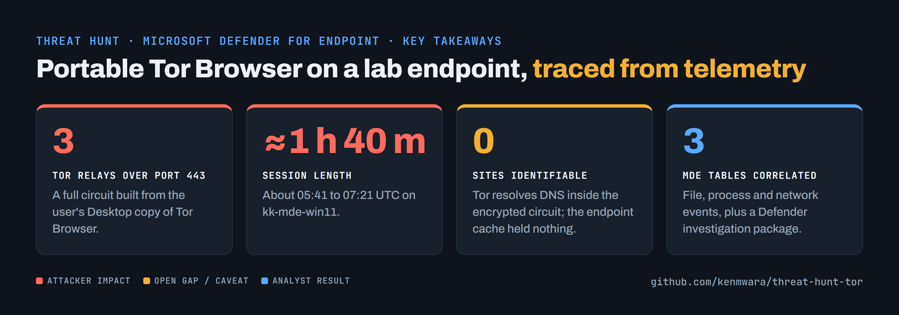

<!-- banner --><a href="https://github.com/kenmwara"></a>

# Threat Hunt Report: Unauthorized Tor Usage

A [Cyber Range](https://www.skool.com/cyber-range) threat-hunting exercise: unauthorized Tor Browser activity was
generated on a dedicated lab VM, then investigated from Microsoft Defender for Endpoint (MDE) telemetry and a Defender
investigation package using the same process as a production endpoint investigation.

## Key takeaways



## Executive summary

User `kk` on `kk-mde-win11` downloaded the portable Tor Browser, ran it from the Desktop, and built a Tor circuit
through three relays over port 443. The session lasted from about 05:41 to 07:21 UTC.

What the evidence does **not** show: which sites were visited. Tor carries its own DNS inside the encrypted circuit,
so the endpoint's DNS cache held nothing, and the traffic content is encrypted end to end. No text files (for example a
notes or "shopping list" file) were created or deleted on the Desktop during the session.

## Platforms and tools

- Windows 11 Pro virtual machine (Microsoft Azure), onboarded to Microsoft Defender for Endpoint
- Microsoft Defender for Endpoint: Advanced Hunting and the "Collect investigation package" response action
- Kusto Query Language (KQL)
- Tor Browser 15.0.20 (portable)

## Scenario

Management suspects employees are using Tor Browser to get around network security controls: network logs show
unusual encrypted traffic, and there are anonymous reports of staff discussing ways to reach restricted sites. The goal
is to detect any Tor usage on the endpoint, reconstruct what happened, and report it.

### IoC discovery plan

- **`DeviceFileEvents`**: any `tor.exe` / `firefox.exe` / `tor-browser*` file activity, or a `Tor Browser` folder
- **`DeviceProcessEvents`**: the installer running, and Tor Browser processes starting
- **`DeviceNetworkEvents`**: outbound connections from `tor.exe` / `firefox.exe`, including (but not only) the
  well-known Tor ports 9001, 9030, 9040, 9050, 9051 and 9150

All times below are UTC on 26 Sep 2026. Device: `kk-mde-win11`. Account: `kk` (the lab VM's local administrator).

---

## Steps taken

### 1. `DeviceFileEvents`: the download and the unpacked browser

Edge saved `tor-browser-windows-x86_64-portable-15.0.20.exe` to `C:\Users\kk\Downloads` at **05:40:45** (SHA256
`508331e09a3484993cb018ac7c62b927f3b4b4feb901f2be2252efe7b4da6620`). From **05:41:08** the installer wrote a full Tor
Browser tree to `C:\Users\kk\Desktop\Tor Browser\` (37 files by 05:49:20, including the browser profile).

```kql
DeviceFileEvents
| where DeviceName == "kk-mde-win11"
| where Timestamp between (datetime(2026-09-26T05:30:00Z) .. datetime(2026-09-26T08:00:00Z))
| where FileName has_any ("tor-browser", "tor.exe", "firefox.exe") or FolderPath has "Tor Browser"
| project Timestamp, ActionType, FileName, FolderPath, SHA256, InitiatingProcessFileName, InitiatingProcessAccountName
| order by Timestamp asc
```

### 2. `DeviceProcessEvents`: the installer runs

At **05:41:02** the account `kk` ran the installer from Downloads. It was launched interactively (no `/S` silent
switch), with Edge as the parent process.

```kql
DeviceProcessEvents
| where DeviceName == "kk-mde-win11"
| where ProcessCommandLine has "tor-browser-windows-x86_64-portable"
| project Timestamp, AccountName, FileName, FolderPath, SHA256, ProcessCommandLine, InitiatingProcessFileName
```

### 3. `DeviceProcessEvents`: Tor Browser actually opened

`firefox.exe` (Tor Browser's front end) first started at **05:41:32**, launched by the installer, and spawned 16
processes by 05:44:43. At **05:41:44** it started `tor.exe` (SHA256
`ea61ba0ed5b89d0622d2894b2a86f5ff34ce9b48e6e40d64341e7c0c7ee03e08`) from the Desktop folder with a SOCKS proxy on
`127.0.0.1:9150` and a control port on `127.0.0.1:9151`.

```kql
DeviceProcessEvents
| where DeviceName == "kk-mde-win11"
| where FileName in~ ("tor.exe", "firefox.exe")
| project Timestamp, AccountName, FileName, FolderPath, SHA256, ProcessCommandLine, InitiatingProcessFileName
| order by Timestamp asc
```

### 4. `DeviceNetworkEvents`: connections into the Tor network

Between **05:41:55 and 05:41:58** `tor.exe` connected out to three relays, all on **port 443**, not 9001:
`89.47.51.90`, `82.165.195.139` and `191.96.11.38`. Defender logged them with random-looking hostnames
(`www.pwj3amcvhnj.com`, `www.rw3veaufk7qe7u.com`, `www.uunagerv73jghqjazi.com`), which Tor generates to disguise its
TLS handshakes. Everything else ran over loopback: Firefox talks to Tor through `127.0.0.1:9150`.

```kql
DeviceNetworkEvents
| where DeviceName == "kk-mde-win11"
| where InitiatingProcessFileName in~ ("tor.exe", "firefox.exe")
| where RemoteIPType != "Loopback"
| project Timestamp, ActionType, RemoteIP, RemotePort, RemoteUrl, InitiatingProcessFileName, InitiatingProcessFolderPath
| order by Timestamp asc
```

A hunt that only watched ports 9001/9050 would have missed all three connections.

### 5. Investigation package: confirming it on the host

At 05:45:41 a Defender investigation package was collected from the device and compared it with a clean package taken
four hours earlier. Only the second one contains:

- **Prefetch** entries for `TOR-BROWSER-WINDOWS-X86_64-PO…pf`, `TOR.EXE…pf` and `FIREFOX.EXE…pf`, which prove the
  programs ran even if the folder is later deleted
- **Running processes**: `tor.exe` running from the user's Desktop under `firefox.exe`
- **Active network connections**: `tor.exe` holding established sessions to all three relays on 443, and listening
  on 9150/9151

---

## Chronological timeline (UTC, 26 Sep 2026)

| Time | Event |
|---|---|
| 05:40:45 | Edge downloads `tor-browser-windows-x86_64-portable-15.0.20.exe` to Downloads |
| 05:41:02 | User `kk` runs the installer (interactive, parent: Edge) |
| 05:41:08 | Tor Browser files start landing in `C:\Users\kk\Desktop\Tor Browser\` |
| 05:41:32 | `firefox.exe` (Tor Browser) starts |
| 05:41:44 | `tor.exe` starts: SOCKS `127.0.0.1:9150`, control `127.0.0.1:9151` |
| 05:41:55–58 | `tor.exe` connects to 3 relays on port 443 |
| 05:45:41 | Analyst collects a Defender investigation package |
| 07:21:10 | Last writes to the Tor Browser profile: the browser is closed |

## Detection gaps found

- **Port-based rules miss modern Tor.** All relay traffic went to 443. Detect on the process (`tor.exe` running from a
  user-writable path), the parent chain (browser → installer → firefox → tor), or known-relay threat intelligence.
- **Software inventory misses portable apps.** The portable build writes no uninstall key, so Installed Programs
  showed nothing. Prefetch and process telemetry caught it.
- **DNS logs are blind to Tor.** The DNS cache had no Tor lookups at all.

## Response taken

- Tor usage confirmed on `kk-mde-win11` by user `kk`; management would be notified with this report.
- Evidence preserved: a Defender investigation package collected at 05:45:41 UTC.
- In a real environment: isolate the device while the user is interviewed, remove the Tor Browser folder, and block
  execution of unsigned binaries from user profile paths (for example with WDAC or AppLocker).
- The detection rules above are candidates for a custom detection in Defender.

## MITRE ATT&CK

- **T1090.003** Proxy: Multi-hop Proxy (Tor)
- **T1573** Encrypted Channel
- **T1204.002** User Execution: Malicious File (an unapproved installer run by the user)

---

*Lab note: the activity was generated deliberately on a dedicated Azure lab VM in the Cyber Range and investigated
without reference to the generation steps.*
